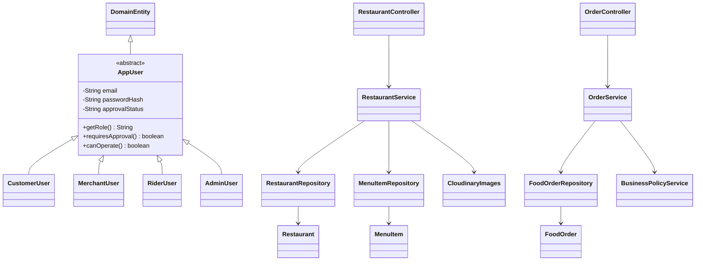
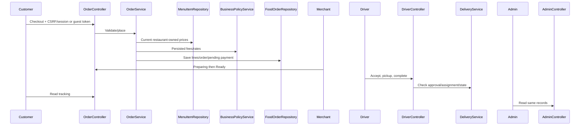

# OOP structure and viva notes

Encapsulation/information hiding: private fields, service-level validation/ownership and protected credential/token/encrypted bank details. Abstraction: AppUser's common contract and Spring Data repositories. Meaningful inheritance/polymorphism: CustomerUser.requiresApproval=false; MerchantUser/RiderUser require approval through the same AppUser contract. Inheritance is not forced onto unrelated services.

Controller → Service → Repository → Model separation remains simple. CloudinaryImages is one boundary service with nested ImageReference record. BusinessPolicyService reads actual database fees/rates. CRUD examples include menu create/read/update/archive, favourites, bank accounts, offers and completed-order reviews. IDs are generated by the database. See the full tree for max-five compliance including tests.

This integration continues the delivered NEW backend baseline; no old backend was substituted/copied during this phase. This is workspace provenance, not an independent forensic guarantee for every historical line.
