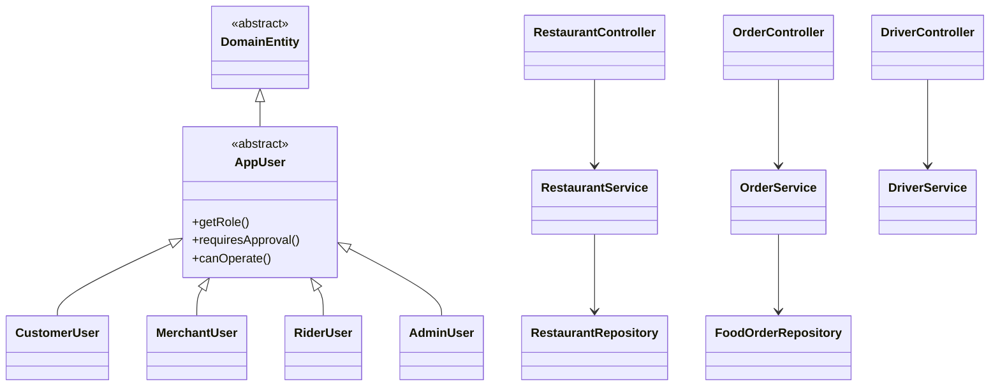

# New implementation provenance and OOP architecture

Backend code was authored in work/fresh-foodie/Foodie/backend during this implementation. No previous Foodie backend source was copied into this package. Standard third-party Maven dependencies/cache were reused; they are not previous application code. This is a process/provenance statement, not a claim that generic Java patterns are mathematically unique. The old backend is excluded from both archives.

Encapsulation/information hiding: domain fields are private, password/token hashes and bank ciphertext are excluded from serialization; services validate transitions and ownership rather than exposing repository writes. Abstraction: abstract DomainEntity provides generated identifiers/versioning; abstract AppUser defines shared user behavior. Inheritance: CustomerUser, MerchantUser, RiderUser and AdminUser extend AppUser. Polymorphism: role-specific getRole/requiresApproval implement the shared contract. Repositories abstract persistence. Controllers delegate to transactional services. See BACKEND_STRUCTURE.txt for the exact 71-file, 22-package inventory (maximum five files per package including tests).

Six responsibilities: User (registration/auth/approval/documents); Restaurant/Menu (restaurant and menu CRUD, generated IDs); Order (checkout/pricing/consent/rewards/history); Payment (cash/banks/payouts/refunds); Delivery (offers/assignment/pickup/completion/driver earnings); Review and administration (reviews, offers, complaints, reports, notifications). Assigning authorship, individual Git marks, presentation marks and teamwork marks must reflect the team's real contributions; no artificial commits were created.

All production orders, favourites, catalog entries, approvals, documents, balances and operational records use database persistence. Monetary policies are environment configuration, not fake business records. Synthetic fixtures and mocked SMTP exist only in test scope. There is no seed catalog, fake delivery, simulated card success or automatic bank success. Browser-only original UI data remains disconnected until API wiring is approved.

Database safety: migrations V1–V5 create/extend only the new nf_ tables. They were applied against isolated H2 MySQL-mode databases and validated by Hibernate. No live Aiven connection, migration, record deletion or overwrite was performed. Dedicated deployment database required before real MySQL verification. Live SMTP, payment gateway and bank execution are unverified/unconfigured. Notification tests assert transaction-safe mail handling using a test double, not inbox delivery.
